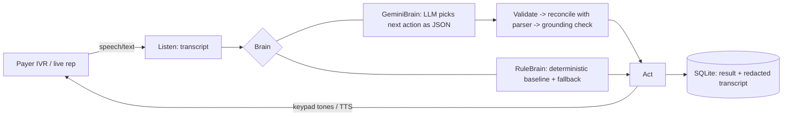

# claim-status-voice-agent

[](https://github.com/YOUR_USER/claim-status-voice-agent/actions/workflows/ci.yml)
<!-- replace YOUR_USER after you push -->

An AI voice agent that **phones a payer, navigates the IVR (or talks to a live rep), retrieves the status of a claim, and returns structured, validated data** - the "check claim status" call that RCM teams make thousands of times a day. Powered by **Google Gemini** (works on the free tier).

```
$ python -m csva run --scenario ivr_denied_medical_necessity

 PAYER  ...For claim status, press 2. To speak with a representative, press 0.
 AGENT  [DTMF 2]
 PAYER  Please enter the ten digit N P I of the billing provider...
 AGENT  [DTMF 1234567890#]
   ...
 PAYER  Status: denied. Denial code CO-50: The service was not medically necessary. Billed amount $310.00...
 AGENT  [DTMF 9]

{ "status": "denied", "denial_code": "CO-50", "billed_amount": 310.0, "paid_amount": 0.0,
  "reference_number": "REF-25838", "next_action": "appeal" }
```

> **Everything here is synthetic.** The "insurer" is a mock phone system I wrote. No real payer, no real PHI.

## Why this is more than a chatbot

| Real-world problem | How it is handled |
|---|---|
| IVR menu trees, keypad vs. speech input | Agent picks `dtmf` / `say` / `wait` each turn |
| Hold music, "please hold" | Stays silent instead of talking over it |
| Dropped input / "sorry, I didn't get that" | Bounded retry, then the other channel |
| Live rep needs identity verification | Gives only the *minimum necessary* identifiers, only when asked |
| **LLM hallucinating an amount or code** | 3 layers: result discarded if the payer hadn't said it yet -> deterministic parser overrides the model on conflict -> **grounding check nulls any ID/amount the payer never actually said** |
| Free-tier rate limits (HTTP 429) | Request throttle (`--rpm`) + exponential backoff |
| API outage / malformed model output | Falls back to the rule policy; every fallback is **counted and reported** so it can't inflate LLM metrics |
| Bad API key / unknown model | **Aborts loudly** (`csva doctor` tells you why) instead of silently degrading |
| PHI in logs | Stored transcripts are redacted (member ID, DOB, patient name) |

## Architecture



Two ways to put a "phone" on the other end, same agent code:

1. **Simulated** (`mock_insurer.py`): offline and deterministic. Used for tests, the benchmark and demos.
2. **Real calls** (`twilio_server.py`): FastAPI webhook; Twilio does speech-to-text via `<Gather>`.

## Quickstart (no keys needed)

```bash
pip install -e ".[dev]"          # Python >= 3.10
python -m csva run --scenario ivr_denied_medical_necessity
python -m csva run --scenario rep_denied --delay 0.5     # human-rep path; --delay is for screen recording
make check                       # lint + types + tests + coverage + benchmark gate (same as CI)
```

Scenarios: `ivr_paid`, `ivr_denied_medical_necessity` (CO-50), `ivr_denied_missing_info` (CO-16), `ivr_pending`, `ivr_claim_not_found`, `ivr_flaky_input_retry`, `rep_denied`, `rep_paid`.

## Using Gemini (free tier)

1. Get a free key at <https://aistudio.google.com/apikey> (no credit card).
2. ```bash
   pip install -e ".[gemini]"
   export GEMINI_API_KEY=...            # Windows PowerShell: $env:GEMINI_API_KEY="..."
   python -m csva doctor                # checks key, lists models your key can use, makes a test call
   python -m csva run --brain gemini --scenario ivr_flaky_input_retry
   ```
3. **Free-tier tips.** Limits are per project and per model, and they change, so check the rate-limit page in AI Studio.
   - `--rpm 8` (default; or `CSVA_RPM`) throttles requests; raise it if your quota allows.
   - Each call costs ~8 requests. Save quota with `--only ivr_paid,rep_denied`.
   - The default model is `gemini-2.5-flash-lite`. If `doctor` says it's unavailable to your key, set `GEMINI_MODEL=<name from doctor's list>`.

```bash
python -m csva benchmark --brain gemini --only ivr_denied_medical_necessity,rep_denied,ivr_flaky_input_retry --out results/benchmark_gemini
```

### Real phone calls (optional)

```bash
pip install -e ".[gemini,twilio]"
export CSVA_BRAIN=gemini GEMINI_API_KEY=... TWILIO_ACCOUNT_SID=... TWILIO_AUTH_TOKEN=... TWILIO_FROM=+1...
python -m csva serve &  &&  ngrok http 8000
python scripts/place_call.py --to <a number you own> --public-url https://<id>.ngrok-free.app --case ivr_paid
```

The webhook flow is covered by automated tests that drive a full call through the real FastAPI routes. The Twilio leg itself needs your credentials, so test it yourself before claiming it works live. Twilio trial accounts can only call verified numbers.

## Testing & CI

143 tests, ~97% branch coverage (CI enforces >= 90%). Everything runs offline: Gemini is replaced by a scriptable fake client.

| What is tested | How |
|---|---|
| Parser (codes, amounts, spoken digits) | Unit + property-based fuzzing (Hypothesis) |
| Fake payer state machine | Scripted flows for IVR and rep + fuzzing with random key/speech sequences |
| Every scenario end to end | Parametrized, all fields checked against DB ground truth |
| Gemini brain failure modes | 429 retry + backoff, retries exhausted, 400/401/403/404 abort, bad JSON, empty/blocked output, throttling |
| Hallucination defences | Model lies about status/amounts/IDs, claims a result too early, invents a check number |
| Benchmark gate | **Mutation tests**: sabotage each extracted field; the gate must fail |
| Twilio webhooks | Full calls through the real routes, interrupted-call persistence |
| PHI | Redaction, DB never contains member ID / DOB / name |
| Packaging | Wheel is built, installed in a clean venv away from the source, and a call is run |

**GitHub Actions** (`.github/workflows/ci.yml`):

| Job | Does |
|---|---|
| `lint` | ruff lint + format check, mypy |
| `test` | Python 3.10 / 3.11 / 3.12 / 3.13 (+ non-blocking Windows), coverage >= 90%, artifacts |
| `benchmark` | All scenarios x5, **fails on any regression**, results in the job summary |
| `package` | `python -m build`, `twine check --strict`, install wheel in clean venv and run it |
| `live-gemini` | Manual only: real Gemini smoke tests (add a `GEMINI_API_KEY` repo secret, then Actions -> Run workflow -> tick `run_live`) |
| `gate` | Single required status check for branch protection |

Also: weekly scheduled run to catch dependency drift, Dependabot, pre-commit config, `make check` to run the whole pipeline locally.

## Results

**Rule-based baseline** (`results/benchmark_rules.md`, 160 simulated calls, every field of every result checked against the payer database): 100% call success, 100% field accuracy, ~8 turns per call.

Read this honestly: the rule brain and the mock payer were written by the same person, so 100% is expected. It is a **regression harness and floor**, not evidence of real-world accuracy. The interesting number is the one below.

**Gemini brain** - *fill in after you run it with your key:*

| Metric | Value |
|---|---|
| Model | _from `doctor`_ |
| Call success / field accuracy | _run `csva benchmark --brain gemini`_ |
| Decision latency p50 / p95 | |
| Fallbacks to rules / values dropped by grounding | |

"Decision latency" is the LLM round trip only: `--rpm` throttle waits and retry backoff are excluded, so rate limiting doesn't inflate it. End-to-end voice latency (STT + LLM + TTS) is a separate number to measure once audio streaming is added.

## Safety and compliance notes

- Synthetic data only. Never run this against a real payer with real patient data without a BAA, written authorization, and compliance sign-off.
- Free-tier Gemini data may be used by Google to improve products. Another reason never to send real PHI through it.
- Minimum-necessary: the agent only discloses identifiers the payer asks for.
- Stored transcripts are redacted; `result_json` holds only claim outcome fields.

## Layout

```
src/csva/
  models.py         Pydantic: ClaimQuery, ClaimStatusResult, Action, CallRecord
  mock_insurer.py   Fake payer: IVR tree, hold music, input errors, live rep
  brains.py         RuleBrain + GeminiBrain (throttle, retry, JSON actions, guardrails, fallback)
  parsing.py        Deterministic extraction + reconcile() + ground() anti-hallucination checks
  agent.py          Listen -> decide -> act loop, PHI redaction
  diagnostics.py    `csva doctor`
  db.py  benchmark.py  cli.py  twilio_server.py
  data/             Synthetic payer DB + scenarios (shipped inside the wheel)
tests/              143 tests (+ opt-in live tests)
```

## Roadmap

- [ ] Media Streams + Deepgram (STT) + ElevenLabs/Cartesia (TTS) for sub-second voice latency and barge-in
- [ ] Hold detection from audio, with timeout and callback
- [ ] Multi-payer IVR profiles learned from transcripts
- [ ] Denial-code RAG: explain CARC/RARC and draft the appeal or resubmission
